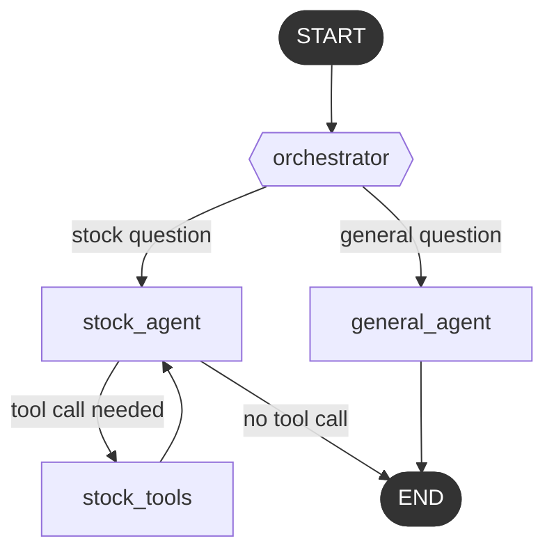

# LangGraph Multi-Agent Orchestrator


A small multi-agent chatbot built with [LangGraph](https://github.com/langchain-ai/langgraph). An **orchestrator** node reads each user message and routes it to either a **stock agent** (which can call a tool to look up stock prices) or a **general agent** (plain chat). Conversation memory is kept across turns using LangGraph's in-memory checkpointer.

## Features

- **Orchestrator routing** — an LLM call decides, per message, whether the question belongs to the stock agent or the general agent.
- **Tool-calling agent loop** — the stock agent can call a `get_stock_price` tool and loop back on itself until it has a final answer.
- **Conversation memory** — `InMemorySaver` checkpointer keeps the message history for the session's thread.
- **LLM via OpenRouter** — uses `langchain`'s `init_chat_model` pointed at the OpenRouter API.
- **LangSmith tracing** — the main chat function is wrapped with `@traceable` for run tracing.

## Architecture



The graph is compiled with a checkpointer (`InMemorySaver`), so conversation history persists across turns within the same `thread_id`.

## Project Structure

| Path | Description |
|---|---|
| `main.py` | Entry point: defines the graph, nodes, tool, and the CLI chat loop |
| `src/first_project/` | Project package (scaffold) |
| `pyproject.toml` | Project metadata and dependencies (for `uv`) |
| `uv.lock` | Locked dependency versions for `uv` |
| `requirements.txt` | Dependencies for users not using `uv` |
| `.env.example` | Template listing the required environment variables |

## Getting Started

1. Clone the repository.
2. Install dependencies, either with `uv`:

   ```bash
   uv sync
   ```

   or with a plain virtual environment:

   ```bash
   python -m venv .venv
   source .venv/bin/activate
   pip install -r requirements.txt
   ```

3. Copy `.env.example` to `.env` and fill in your keys:

   ```bash
   cp .env.example .env
   ```

4. Run the chatbot:

   ```bash
   python main.py
   ```

   Type your message at the `You:` prompt, and `exit` or `quit` to stop.

## Environment Variables

| Variable | Description |
|---|---|
| `OPENROUTER_API_KEY` | API key for [OpenRouter](https://openrouter.ai/), used as the LLM provider |
| `OPENAI_API_KEY` | OpenAI API key (optional, depending on provider setup) |
| `LANGSMITH_TRACING` | Set to `true` to enable LangSmith tracing |
| `LANGSMITH_ENDPOINT` | LangSmith API endpoint |
| `LANGSMITH_API_KEY` | API key for LangSmith |
| `LANGSMITH_AGENT_ID` | LangSmith agent identifier |
| `LANGSMITH_AGENT_ENVIRONMENT` | LangSmith environment label |

> **Note:** OpenRouter requires account credits to serve LLM requests — make sure your OpenRouter account has credits before running the app.

## Example Questions

- "What's the stock price of MSFT?" — routed to the stock agent, which calls the `get_stock_price` tool.
- "What's the capital of France?" — routed to the general agent for a plain chat answer.

> **Note:** The stock prices returned by `get_stock_price` are sample hard-coded values (for `MSFT`, `AAPL`, `AMZN`, `RIL`), not live market data.

## Security

API keys are read from environment variables via `python-dotenv` and are never hard-coded in the source. Never commit your real `.env` file — only `.env.example` (with empty placeholders) is tracked in version control.
